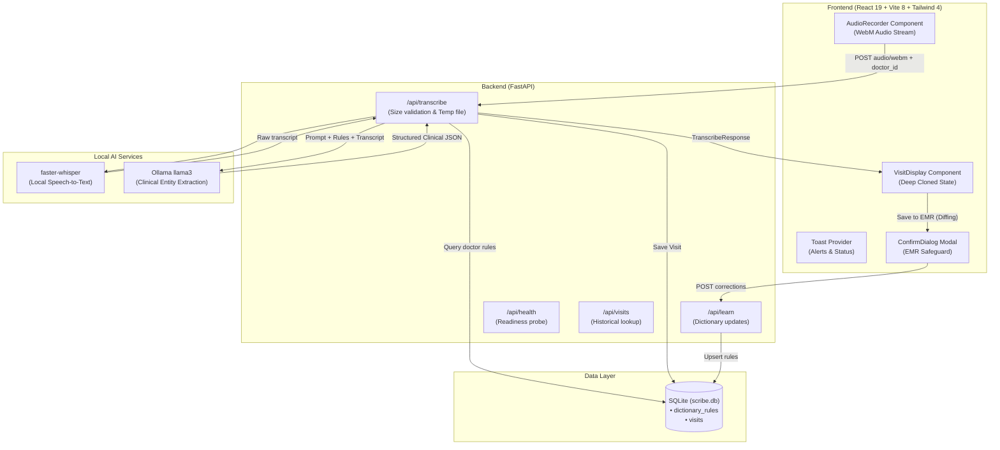

# MedicalScribe 2.0 🩺

An intelligent, self-learning AI clinical scribe designed to record patient-doctor encounters, transcribe consultations, extract structured clinical documentation, and automatically adapt to doctor-specific terminology.

---

## 🌟 Key Features

- **⚡ Ultra-Fast Groq Cloud LPU Pipeline (~1.5s Total Latency):**
  - **Speech-to-Text:** Groq `whisper-large-v3-turbo` transcribes 60s of clinical audio in **~400ms**.
  - **Clinical Reasoning:** Groq `llama-3.3-70b-versatile` / `llama-3.1-8b-instant` outputs formatted JSON in **~800ms**.
  - **Instant 1-Click UI Switch:** Configure your free Groq key directly in the web app or in `backend/.env`.
- **🖥️ Optimized Local CPU Fallback (100% Offline):** Powered by `faster-whisper` (Silero VAD + greedy beam) and local Ollama (`llama3.2:3b` / `llama3`).
- **Structured Note Generation:** Clinical entity extraction into standardized sections:
  - Patient Demographics (Name, Age, Gender)
  - History of Present Illness (HPI)
  - Past Medical History (PMH)
  - Allergies
  - Symptoms (Name, Severity, Duration, Details)
  - Diagnoses & Conditions (Name, Status, Notes)
  - Medications (Name, Drug Class, Dosage, Route, Frequency, Duration, Purpose)
  - Clinical Procedures
  - Follow-up Plan & Instructions
- **Self-Learning Correction Dictionary:** When a clinician corrects misheard names, conditions, symptoms, or medication names before saving to EMR, the system records these rules and injects them into future transcription prompts for that doctor.
- **Persistent Visit Storage:** Automatically records each visit, raw transcript, and generated notes to SQLite with unique record IDs.
- **Resilient Frontend Architecture:** Built with React 19, Tailwind CSS 4, Lucide icons, deep-cloned immutable state updates, toast notification context, and modal confirmation safeguards.

---

## 🏗️ System Architecture



---

## 🚀 Getting Started

### Prerequisites

1. **Python 3.10+**
2. **Node.js 18+** and `npm`
3. **Ollama** installed and running with `llama3`:
   ```bash
   ollama run llama3
   ```

---

### Backend Setup

1. Open a terminal and navigate to `backend/`:
   ```bash
   cd backend
   ```
2. Activate your virtual environment:
   ```bash
   # Windows PowerShell
   .\venv\Scripts\Activate.ps1

   # Linux / macOS
   source venv/bin/activate
   ```
3. Install dependencies:
   ```bash
   pip install -r requirements.txt
   ```
4. Start the FastAPI server:
   ```bash
   python main.py
   # or
   uvicorn main:app --host 0.0.0.0 --port 8000 --reload
   ```
   The backend API will be available at `http://localhost:8000`.
   API Documentation is available at `http://localhost:8000/docs`.

---

### Frontend Setup

1. Open another terminal and navigate to `frontend/`:
   ```bash
   cd frontend
   ```
2. Install dependencies (if not already done):
   ```bash
   npm install
   ```
3. Start the Vite dev server:
   ```bash
   npm run dev
   ```
   The application will be live at `http://localhost:5173`.

---

## 📡 API Endpoints

| Method | Path | Description |
|---|---|---|
| `GET` | `/api/health` | Health check verifying Whisper and Ollama status |
| `POST` | `/api/transcribe` | Uploads audio recording, returns transcript and structured notes |
| `POST` | `/api/learn` | Saves corrected medical terms into doctor-specific dictionary |
| `GET` | `/api/dictionary/{doctor_id}` | Retrieves all learned correction rules for a doctor |
| `GET` | `/api/visits?doctor_id=...` | Lists saved clinical visits for a doctor |
| `GET` | `/api/visits/{visit_id}` | Fetches a single visit with transcript and structured notes |

---

## 🛡️ Self-Learning Dictionary Explained

When audio contains phonetic homophones (e.g., *“Metformin”* recognized as *“met forming”*, or a patient named *“Aarav”* misheard as *“Arab”*):

1. The doctor reviews the transcribed notes on screen and updates the name or term.
2. When clicking **Save to EMR**, the frontend computes the semantic diff specifically on clinical entity names.
3. The corrections are sent to `/api/learn` and recorded in SQLite under `dictionary_rules`.
4. Subsequent calls to `/api/transcribe` inject the updated rules into the prompt:
   ```
   DOCTOR DICTIONARY:
   'met forming' usually means 'Metformin', 'listen april' usually means 'Lisinopril'
   ```
5. Ollama uses contextual clues and the dictionary rules to automatically fix spelling mistakes in all future encounters.

---

## 📄 License
MIT License. Medical AI research prototype.
